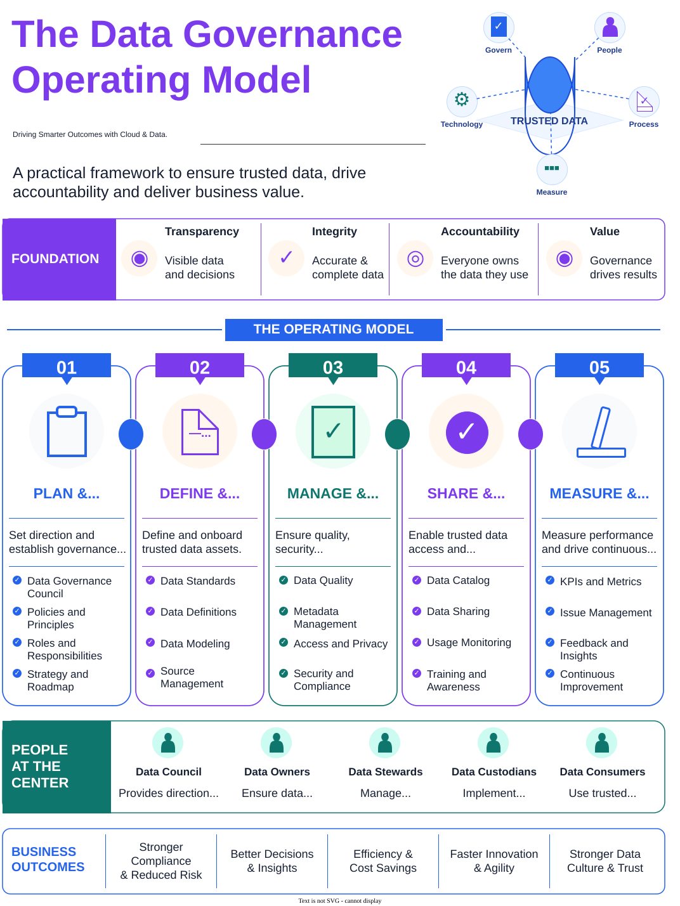

<h1 id="data-governance-operating-model" style="margin:0;color:inherit;">✦ Data Governance Operating Model</h1>

> **A practical system for trusted data and better decisions.**  
> Governance connects clear decision rights, fit-for-purpose controls and measurable business outcomes across the full data lifecycle.

**Model at a glance**

| 🧭 Foundations | 🔄 Lifecycle | 👥 Accountability | ✨ Outcomes |
|---|---|---|---|
| Transparency · Integrity · Accountability · Value | Plan · Define · Protect · Share · Improve | Council · Owners · Stewards · Custodians · Consumers | Trust · Risk reduction · Better decisions · Agility |

<strong>✨ Visual guide - expand to view the three diagrams</strong>

 

**01 · Data Governance Operating Model**

**02 · Cross-cutting Governance Capabilities**

**03 · Trust, Privacy &amp; Resilience Guardrails**

**In this guide:** [Foundations](#2-four-foundations) · [Lifecycle](#3-five-stage-governance-lifecycle) · [Roles](#4-people-at-the-center) · [Measures](#5-business-outcomes-and-useful-measures) · [Capabilities](#12-cross-cutting-governance-capabilities)

---

<h2 id="1-purpose-trusted-data-that-produces-business-value" style="margin:0;color:inherit;">1. Purpose: trusted data that produces business value</h2>

The model connects three goals:

1. **Trusted data:** users understand what data means, where it comes from, its quality and its permitted uses.
2. **Accountability:** identifiable people have the authority and responsibility to make and enforce decisions.
3. **Business value:** governance improves decisions, reduces risk and enables useful work rather than becoming an isolated documentation exercise.

Data governance defines decision rights, policies and accountability. Data management executes the work: collecting metadata, fixing quality issues, implementing access controls, operating platforms and maintaining assets. The two must be connected; a policy without an operational mechanism is unlikely to change behavior.

<h2 id="2-four-foundations" style="margin:0;color:inherit;">2. Four foundations</h2>

<h3 id="21-transparency" style="margin:0;color:inherit;">2.1 Transparency</h3>

**Meaning:** visible data and decisions.

People should be able to discover governed assets, understand their definitions and see how governance decisions were made. Transparency does not mean unrestricted access to sensitive data.

Recommended practices:

- Publish business definitions, ownership and intended use in an accessible catalog.
- Record provenance, important transformations and known limitations.
- Maintain a decision log for policy changes, access exceptions and disputed definitions.
- Explain quality status and whether an asset is approved for a particular purpose.
- Restrict sensitive metadata when even an asset's existence or description is confidential.

**Evidence:** a catalog entry with owner, definition, lineage and limitations; a traceable decision record.

<h3 id="22-integrity" style="margin:0;color:inherit;">2.2 Integrity</h3>

**Meaning:** accurate and complete data.

Integrity means that data is sufficiently correct and complete for a stated purpose. It also requires preserving meaning through transformations. A dataset can be validly formatted yet still be misleading.

Recommended practices:

- Define business-specific quality rules and materiality thresholds.
- Check completeness, accuracy, validity, consistency, uniqueness and timeliness where relevant.
- Reconcile important totals or records against authoritative sources.
- Assign remediation to the team that can correct the cause, not just the downstream symptom.
- Publish exceptions and quality limitations rather than silently discarding failed records.

**Evidence:** versioned rules, measured results, exceptions and verified remediation.

<h3 id="23-accountability" style="margin:0;color:inherit;">2.3 Accountability</h3>

**Meaning:** ownership of the data being used.

Recommended practices:

- Name an accountable owner for each critical asset or domain.
- Define the owner's authority to approve definitions, quality expectations and access policy.
- Appoint stewards for day-to-day coordination and custodians for technical controls.
- Record deputies, escalation paths and handovers.
- Revisit ownership after reorganizations and system changes.

**Evidence:** an ownership register, decision rights and a maintained responsibility matrix.

<h3 id="24-value" style="margin:0;color:inherit;">2.4 Value</h3>

**Meaning:** governance drives results, not just compliance.

Prioritize work by the business decisions, risks and user journeys it improves. Catalog completeness is useful only when it contributes to outcomes such as faster discovery or fewer reporting errors.

Recommended practices:

- Identify the business use case before selecting tools.
- Baseline the current problem and its cost or risk.
- Fund a small number of high-value domains first.
- Measure outcomes as well as activities.
- Retire controls or processes that duplicate work without reducing material risk.

**Evidence:** a use-case backlog with sponsors, expected benefit and measured results.

<h2 id="3-five-stage-governance-lifecycle" style="margin:0;color:inherit;">3. Five-stage governance lifecycle</h2>

**Plan & Govern &rArr; Define & Create &rArr; Manage & Protect &rArr; Share & Use &rArr; Measure & Improve**

Treat this as a recurring lifecycle, not a one-time waterfall. Findings from measurement should change priorities, definitions, controls and training. Existing assets can require work in several stages at once.

<h3 id="31-stage-01-plan-govern" style="margin:0;color:inherit;">3.1 Stage 01: Plan &amp; Govern</h3>

**Purpose:** set direction and establish the governance structure.

**Activities:**

- Data Governance Council.
- Policies and principles.
- Roles and responsibilities.
- Strategy and roadmap.

**Recommended implementation:**

1. Select the initial scope: a domain, critical report, data product or business process.
2. Identify stakeholders and the business problem governance should solve.
3. Establish a council with a charter, authority, membership and escalation route.
4. Define policy ownership and how exceptions are approved and reviewed.
5. Name owners, stewards and custodians with realistic capacity.
6. Publish a prioritized roadmap tied to outcomes and dependencies.

**Inputs:** strategy, stakeholder needs, known incidents, obligations and current-state assessments.

**Outputs:** charter, policy set, role register, issue escalation model and funded roadmap.

**Suggested readiness check:** the scope, sponsor, owner and decision authority are known; participants understand how to resolve a dispute.

**Common failure:** forming a council that meets regularly but cannot make or enforce decisions.

<h3 id="32-stage-02-define-create" style="margin:0;color:inherit;">3.2 Stage 02: Define &amp; Create</h3>

**Purpose:** define and onboard trusted data assets.

**Activities:**

- Data standards.
- Data definitions.
- Data modeling.
- Source management.

**Recommended implementation:**

1. Inventory the relevant sources and identify critical data elements.
2. Define important business terms and distinguish similar concepts.
3. Agree naming, identifiers, units, formats, permissible values and schema rules.
4. Record authoritative sources and source-to-target mappings.
5. Model key entities and relationships.
6. Register each asset with its owner, purpose and initial quality expectations.

**Inputs:** scoped business requirements, existing schemas, source documentation and stakeholder definitions.

**Outputs:** glossary, asset register, data model, source register and onboarding record.

**Suggested readiness check:** a new consumer can understand the asset's meaning, source, limitations and owner without relying on informal knowledge.

**Example:** "active customer" needs an agreed time window, activity definition and exclusions. A field named `active_flag` alone does not establish a shared business meaning.

**Common failure:** treating a catalog upload as complete onboarding while definitions remain disputed.

<h3 id="33-stage-03-manage-protect" style="margin:0;color:inherit;">3.3 Stage 03: Manage &amp; Protect</h3>

**Purpose:** maintain quality, security and compliance.

**Activities:**

- Data quality.
- Metadata management.
- Access and privacy.
- Security and compliance.

**Recommended implementation:**

1. Implement quality checks with owners, thresholds and remediation workflows.
2. Maintain metadata and lineage as schemas and pipelines change.
3. Classify data and map classification to handling requirements.
4. Apply least-privilege access, appropriate encryption and audit logging.
5. Define retention, deletion and recovery requirements.
6. Review controls, access exceptions and known quality limitations regularly.

**Inputs:** definitions, classifications, approved policies and business risk.

**Outputs:** quality scorecards, control evidence, access records, issue backlog and documented exceptions.

**Suggested readiness check:** controls are implemented and tested, quality failures are visible and material issues have accountable remediation.

**Important distinction:** a data owner accepts business accountability; a custodian operates controls. Technical staff should not silently become the final authority for business risk.

**Common failure:** correcting data manually in a report without fixing the upstream cause.

<h3 id="34-stage-04-share-use" style="margin:0;color:inherit;">3.4 Stage 04: Share &amp; Use</h3>

**Purpose:** enable trusted data access and collaboration.

**Activities:**

- Data catalog.
- Data sharing.
- Usage monitoring.
- Training and awareness.

**Recommended implementation:**

1. Make permitted assets discoverable with clear descriptions and ownership.
2. Provide access-request and approval paths with purpose and scope.
3. Define sharing agreements, permissible uses and downstream responsibilities.
4. Publish supported APIs, extracts or data products with known freshness and quality.
5. Monitor use proportionately and protect the privacy of usage information.
6. Train consumers to interpret data correctly and report problems.

**Inputs:** registered assets, current quality status and access policy.

**Outputs:** catalog listings, approved sharing arrangements, usage records and learning material.

**Suggested readiness check:** an authorized consumer can find, request and use the right data safely, with a clear support route.

**Common failure:** optimizing approval speed while ignoring whether the data is fit for the consumer's purpose.

<h3 id="35-stage-05-measure-improve" style="margin:0;color:inherit;">3.5 Stage 05: Measure &amp; Improve</h3>

**Purpose:** measure performance and drive continuous improvement.

**Activities:**

- KPIs and metrics.
- Issue management.
- Feedback and insights.
- Continuous improvement.

**Recommended implementation:**

1. Measure outcomes and leading indicators against a documented baseline.
2. Register quality, access, definition and control issues in a shared workflow.
3. Prioritize issues by impact, severity and affected use cases.
4. Analyze root causes and verify fixes.
5. Gather consumer feedback and identify unnecessary process friction.
6. Feed findings into the council's priorities, standards and roadmap.

**Inputs:** quality results, incidents, usage evidence, business outcomes and feedback.

**Outputs:** scorecards, issue trends, verified remediations and an updated improvement backlog.

**Suggested readiness check:** metrics have definitions and owners, important issues progress to verified closure, and findings cause observable changes.

**Common failure:** marking an issue closed after deploying a fix without checking that the affected business outcome improved.

<h2 id="4-people-at-the-center" style="margin:0;color:inherit;">4. People at the center</h2>

| Role | Responsibility in the images | Recommended practical decision rights |
|---|---|---|
| Data Council | Direction and oversight | Set cross-domain priorities, approve overarching policy and resolve escalated disputes |
| Data Owners | Ensure data quality | Accept domain accountability; approve definitions, fit-for-purpose expectations and permitted-use policy |
| Data Stewards | Manage standards | Maintain definitions and metadata, coordinate quality rules and triage issues |
| Data Custodians | Implement controls | Operate platforms, pipelines, security, access and recovery mechanisms |
| Data Consumers | Use trusted data | Follow conditions of use, validate fitness for their decision and report issues |

Roles describe responsibilities, not necessarily separate job titles. One person may hold more than one role in a small organization, but conflicts of interest and high-risk approvals may require separation.

Owners need authority and time, not just a name in a spreadsheet. Stewards should have access to domain experts and custodians; consumers need a practical way to challenge unclear or unfit data.

<h3 id="illustrative-responsibility-matrix" style="margin:0;color:inherit;">Illustrative responsibility matrix</h3>

This matrix is an implementation example, not a prescribed allocation from the images.

**A:** accountable decision authority. **R:** responsible for execution. **C:** consulted. **I:** informed. Each row has one accountable role; multiple responsible roles may cooperate.

| Activity | Council | Owner | Steward | Custodian | Consumer |
|---|---|---|---|---|---|
| Approve enterprise governance policy | A | C | R | C | I |
| Approve a domain definition | I | A | R | C | C |
| Set business quality expectations | I | A | R | C | C |
| Implement automated quality checks | I | A | R | R | I |
| Approve permitted use for a governed asset | I | A | R | C | C |
| Implement approved access controls | I | A | C | R | I |
| Coordinate a material data issue | I | A | R | R | C |
| Review cross-domain performance | A | R | R | C | C |

Security, privacy, legal, risk and audit specialists should participate where relevant. These supporting functions do not remove the need for the five named roles.

<h2 id="5-business-outcomes-and-useful-measures" style="margin:0;color:inherit;">5. Business outcomes and useful measures</h2>

The images identify five benefits. They are intended outcomes, not guaranteed results from installing a governance tool.

| Source outcome | How governance contributes | Illustrative measures |
|---|---|---|
| Stronger compliance and reduced risk | Defined handling rules, controls, evidence and accountable exceptions | Overdue high-risk issues; control test results; access review completion |
| Better decisions and insights | Shared definitions, known quality and traceable provenance | Reporting reconciliation errors; decision rework caused by data defects |
| Efficiency and cost savings | Less duplicate discovery, remediation and manual reconciliation | Time to find approved data; repeated extracts; effort spent on recurring fixes |
| Faster innovation and agility | Discoverable reusable assets with clear access and meaning | Time to onboard a use case; time to obtain usable approved data |
| Stronger data culture and trust | Visible ownership, feedback and responsible use | Consumer confidence; catalog adoption; feedback closure and recurring issue trends |

<h3 id="example-metric-definitions" style="margin:0;color:inherit;">Example metric definitions</h3>

Metrics need a scope, calculation, owner, measurement interval and interpretation. Do not select targets until the baseline and risk appetite are understood.

| Metric | Example definition | Caveat |
|---|---|---|
| Ownership coverage | Critical assets with an active named owner / all in-scope critical assets | A name is not evidence that the owner accepts the role |
| Definition coverage | Critical elements with approved current definitions / all in-scope critical elements | Approval age and actual use matter |
| Quality pass rate | Successful applicable rule evaluations / all applicable evaluations in the period | A high average can hide a critical failed rule; report severity separately |
| Access fulfillment time | Median and p95 elapsed time from a complete request to an access decision | Separate approval from technical fulfillment; do not reward unsafe approvals |
| Issue resolution time | Median and p95 time from registration to verified remediation | Track reopened and overdue issues, not only closed tickets |
| Freshness compliance | Observations meeting the defined freshness requirement / all scheduled observations | Define missing observations and distinguish source from pipeline lag |
| Consumer confidence | Survey results tied to named use cases and sample sizes | Survey sentiment should complement measured fitness, not replace it |

For example, 90 owned assets out of 100 critical assets gives 90% ownership coverage. That does not prove any of those 90 assets is accurate, protected or useful.

<h2 id="6-a-practical-operating-rhythm" style="margin:0;color:inherit;">6. A practical operating rhythm</h2>

The following cadence is illustrative and should match scale and risk.

| Cadence | Participants | Focus | Evidence |
|---|---|---|---|
| Daily or event-driven | Custodians and stewards | Failed checks, incidents, access fulfillment and pipeline changes | Alerts, issue updates and execution logs |
| Weekly | Stewards, owners and delivery teams | Quality trends, definitions, remediation and onboarding | Prioritized backlog and decisions |
| Monthly | Owners and council | Cross-domain risks, exceptions, metrics and investment | Scorecard, decision log and roadmap updates |
| Quarterly or material change | Council and supporting specialists | Strategy, policy effectiveness, ownership and benefits | Revised priorities and control review |

Urgent incidents should not wait for a scheduled meeting. Define an incident escalation route, decision authority and communication responsibilities in advance.

<h3 id="suggested-issue-workflow" style="margin:0;color:inherit;">Suggested issue workflow</h3>

1. **Register:** identify the affected asset, symptom, reporter and business impact.
2. **Triage:** classify the issue, identify affected consumers and set priority.
3. **Assign:** name the accountable owner and responsible remediation team.
4. **Contain:** warn users, restrict unsafe use or provide a qualified alternative.
5. **Diagnose:** trace lineage and determine the upstream cause.
6. **Remediate:** correct the source, transformation, control or definition as appropriate.
7. **Verify:** rerun checks and confirm affected outputs and business decisions.
8. **Close and learn:** retain evidence, communicate the outcome and update prevention measures.

Track accepted risk and temporary exceptions separately from fixed defects. An exception needs an approver, reason, expiry and compensating controls; it is not an invisible permanent waiver.

<h2 id="7-worked-example-a-trusted-customer-data-asset" style="margin:0;color:inherit;">7. Worked example: a trusted customer data asset</h2>

This is an explanatory scenario, not an example contained in the images.

<h3 id="plan-govern" style="margin:0;color:inherit;">Plan &amp; Govern</h3>

A customer-service team cannot reconcile customer counts across channels. The council sponsors a scoped customer domain initiative. A named owner is accountable for the definition, while a steward coordinates standards and custodians maintain source integrations.

**Deliverable:** an agreed use case, owner, scope and prioritized roadmap.

<h3 id="define-create" style="margin:0;color:inherit;">Define &amp; Create</h3>

The team defines customer identity, active status, contact attributes and authoritative sources. It records identifiers, matching rules, source mappings and the distinction between an individual and an organization.

**Deliverable:** approved definitions, a customer model and a catalog entry with provenance.

<h3 id="manage-protect" style="margin:0;color:inherit;">Manage &amp; Protect</h3>

Checks detect missing identifiers, duplicate records and stale updates. Contact information is classified, approved access is implemented and use limitations are documented. Merge errors require review rather than silently overwriting identities.

**Deliverable:** quality rules, access controls, monitoring and an exception route.

<h3 id="share-use" style="margin:0;color:inherit;">Share &amp; Use</h3>

Authorized teams discover and request the asset through the catalog. Each consumer sees freshness, limitations and supported contact routes. Training explains that an operational customer count may differ from a regulatory reporting definition.

**Deliverable:** approved distribution channels and fit-for-purpose usage guidance.

<h3 id="measure-improve" style="margin:0;color:inherit;">Measure &amp; Improve</h3>

The team tracks reconciliation discrepancies, freshness, access turnaround and consumer feedback. A recurring duplicate problem is traced to an upstream registration flow, not repeatedly patched in downstream reports.

**Deliverable:** verified remediation and an updated improvement backlog.

<h2 id="8-suggested-phased-adoption" style="margin:0;color:inherit;">8. Suggested phased adoption</h2>

Avoid trying to govern every dataset before proving the operating model.

<h3 id="phase-a-establish-accountability" style="margin:0;color:inherit;">Phase A: establish accountability</h3>

- Choose one material domain or decision.
- Name the sponsor, owner, steward and custodian.
- Agree scope, decision rights and escalation.
- Baseline the principal quality, access or trust problem.

<h3 id="phase-b-onboard-a-small-set-of-critical-assets" style="margin:0;color:inherit;">Phase B: onboard a small set of critical assets</h3>

- Agree definitions, sources and classifications.
- Create usable catalog entries and basic lineage.
- Define quality expectations and permitted uses.
- Implement controls and a visible issue workflow.

<h3 id="phase-c-enable-safe-use-and-measure-results" style="margin:0;color:inherit;">Phase C: enable safe use and measure results</h3>

- Give consumers a practical discovery and access path.
- Publish quality and freshness limitations.
- Train participants and collect feedback.
- Measure a small number of meaningful indicators.

<h3 id="phase-d-refine-and-scale" style="margin:0;color:inherit;">Phase D: refine and scale</h3>

- Verify business improvement and recurring failure causes.
- Adjust policies and tooling based on actual friction.
- Reuse standards and onboarding patterns in the next domain.
- Expand only when ownership and operating capacity can support it.

Progress should be assessed through demonstrated capability and benefit, not just documents produced.

<h2 id="9-minimum-useful-artifact-set" style="margin:0;color:inherit;">9. Minimum useful artifact set</h2>

| Artifact | Minimum useful contents |
|---|---|
| Governance charter | Purpose, scope, authority, membership and escalation |
| Ownership register | Domain/asset, accountable owner, steward, custodian and review date |
| Business glossary | Term, definition, context, owner and approval status |
| Asset/catalog record | Purpose, source, owner, classification, quality, freshness and access route |
| Standards register | Naming, identifiers, schema, quality and metadata conventions |
| Policy and exception register | Handling rules, approval authority, exceptions, expiry and controls |
| Quality scorecard | Rules, scope, results, materiality, trend and issue links |
| Issue register | Impact, owner, priority, actions and verified closure evidence |
| Sharing agreement | Permitted purpose, recipients, conditions and responsibilities |
| Improvement roadmap | Priorities, expected value, capacity and measurable outcomes |

Use existing tools where they can provide these capabilities. Do not create disconnected registers merely to satisfy a checklist.

<h2 id="10-common-pitfalls" style="margin:0;color:inherit;">10. Common pitfalls</h2>

- **Tool-first governance:** selecting a catalog before agreeing ownership and decisions.
- **Unowned assets:** assigning a team alias without a person accountable for decisions.
- **Definitions without adoption:** publishing terms that reporting and applications do not use.
- **Compliance-only success:** counting approvals while discovery, quality and usability remain poor.
- **Unqualified quality scores:** presenting one percentage without purpose, severity or scope.
- **Downstream-only fixes:** repeatedly cleaning reports while source defects continue.
- **Access without purpose:** approving broad access without permitted-use and retention conditions.
- **Permanent exceptions:** accepting risk without an expiry, owner or reassessment.
- **Training as a one-off:** providing onboarding once while staff, systems and policies change.
- **No feedback loop:** measuring issues without changing practices or investment.

<h2 id="11-review-checklist" style="margin:0;color:inherit;">11. Review checklist</h2>

- [ ] Transparency, integrity, accountability and value are reflected in actual decisions.
- [ ] Every critical domain and asset has an active accountable owner.
- [ ] Council, steward, custodian and consumer responsibilities are understood.
- [ ] Definitions, sources and important relationships are documented and used.
- [ ] Quality expectations are tied to the intended business use.
- [ ] Access, privacy, security and lifecycle controls are implemented and tested.
- [ ] Consumers can discover, request and safely use approved data.
- [ ] Issues have owners, prioritization and verified closure.
- [ ] Metrics show business impact as well as governance activity.
- [ ] Feedback changes priorities, standards, controls or training.
- [ ] Applicable legal and regulatory questions involve qualified specialists.
- [ ] Governance continues after initial rollout rather than ending with policy publication.
- [ ] Central versus domain decision rights and risk-tier requirements are explicit.
- [ ] Producer-consumer contracts and certification/retirement criteria are maintained.
- [ ] Shared identities and code lists have accountable authority and correction rules.
- [ ] Policy requirements map to tested controls and current evidence.
- [ ] External sharing and AI use have scoped permissions and review where applicable.
- [ ] Stewardship and remediation commitments have funding and operating capacity.
- [ ] Maturity claims can be reproduced from evidence and inform practical improvements.

<h2 id="12-cross-cutting-governance-capabilities" style="margin:0;color:inherit;">12. Cross-cutting governance capabilities</h2>

The second diagram page, **Cross-cutting Governance Capabilities**, adds ten implementation capabilities to the original five-stage model. A third page adds privacy/lifecycle and resilience/portability guardrails. These are recommendations beyond the supplied images, not additional source-image stages. Capability identifiers C01-C12 are separate from lifecycle stages 01-05. Each capability supports one or more stages and should be scaled to business risk and operating capacity.

| ID | Capability | Lifecycle alignment |
|---|---|---|
| C01 | Federated governance | Plan & Govern; Measure & Improve |
| C02 | Risk-based prioritization | All five stages |
| C03 | Data contracts and change control | Define & Create; Manage & Protect; Share & Use |
| C04 | Asset certification and retirement | Define & Create; Share & Use; Measure & Improve |
| C05 | Master and reference data | Define & Create; Manage & Protect; Share & Use |
| C06 | Policy enforcement and evidence | Plan & Govern; Manage & Protect; Measure & Improve |
| C07 | External data sharing | Plan & Govern; Manage & Protect; Share & Use |
| C08 | AI data governance | All five stages |
| C09 | Funding and capacity | Plan & Govern; Measure & Improve |
| C10 | Maturity assessment | Measure & Improve; Plan & Govern |
| C11 | Privacy, rights and data lifecycle | Define & Create; Manage & Protect; Share & Use; Measure & Improve |
| C12 | Resilience, recovery and portability | Plan & Govern; Manage & Protect; Share & Use; Measure & Improve |

<h3 id="121-c01-federated-governance" style="margin:0;color:inherit;">12.1 C01: Federated governance</h3>

**Purpose:** Balance enterprise consistency with domain autonomy.

**Lifecycle alignment:** Plan & Govern &rarr; Measure & Improve.

**Recommended lead and decision rights:** Council for enterprise policy; domain owner for delegated domain decisions.

**Recommended practices:**

1. Reserve enterprise-wide policy, shared identifiers and cross-domain dispute resolution for the council. Delegate domain definitions, quality expectations and asset decisions within explicit guardrails.
2. Publish a decision-rights matrix with approval thresholds, escalation routes, expected response times and deputies. Shared assets need one designated accountable owner, even when several domains contribute.
3. Let owners and stewards propose local standards while identifying where enterprise compatibility is mandatory. Record approved exceptions with reasons, expiry and compensating controls.
4. Revisit delegations after reorganizations and recurring disputes. Avoid routing every routine decision through the council or allowing conflicting local policy to emerge silently.

**Evidence and artifacts:** Delegation charter; domain map; decision register; escalation and exception records.

**Practical verification:** Trace a cross-domain definition dispute from proposal to an accountable decision; confirm affected domains adopt the resolution.

<h3 id="122-c02-risk-based-prioritization" style="margin:0;color:inherit;">12.2 C02: Risk-based prioritization</h3>

**Purpose:** Apply effort and controls in proportion to business impact.

**Lifecycle alignment:** All five stages.

**Recommended lead and decision rights:** Data owner, with council oversight and specialist advice where required.

**Recommended practices:**

1. Identify critical data elements by the decisions, customer journeys, reporting and obligations they support. Do not equate criticality only with personal-data classification.
2. Assess impact, sensitivity, exposure, dependency reach, quality uncertainty and recovery needs using a documented rubric. Record the assumptions and reasons behind each rating.
3. Map risk tiers to minimum ownership, quality, access, lineage, review and recovery requirements. A low aggregate score must not cancel a mandatory handling obligation.
4. Prioritize remediation by material risk and use-case value; review assessments after incidents, source changes and new uses. Use qualified specialists for legal or regulatory interpretation.

**Evidence and artifacts:** Critical-data register; risk rubric; tier-to-control mapping; prioritized remediation backlog.

**Practical verification:** Sample a high-impact element and a routine asset; verify different controls are justified and mandatory requirements remain enforced.

<h3 id="123-c03-data-contracts-and-change-control" style="margin:0;color:inherit;">12.3 C03: Data contracts and change control</h3>

**Purpose:** Make producer-consumer expectations explicit and changes predictable.

**Lifecycle alignment:** Define & Create &rarr; Manage & Protect &rarr; Share & Use.

**Recommended lead and decision rights:** Producing asset owner, consulting affected consumer owners.

**Recommended practices:**

1. Define schema, business meaning, identifiers, units, nullability, quality, freshness, delivery expectations, permitted use, support routes and ownership in a versioned contract.
2. Use lineage and a consumer register to assess change impact. Require notice and an agreed migration plan for breaking changes, including semantic changes that schema checks cannot detect.
3. Validate contracts in pipelines, test old and new consumers, and use compatible transition periods where necessary. Specify incident notification, late-data treatment and exception handling.
4. Keep evidence of approval, deployment, validation and deprecation. Technical contracts do not replace legal data-sharing agreements.

**Evidence and artifacts:** Versioned contract; consumer register; impact assessment; compatibility results; migration and rollback plan.

**Practical verification:** Change a field's unit without changing its type; verify semantic review detects the break and consumers migrate deliberately.

<h3 id="124-c04-asset-certification-and-retirement" style="margin:0;color:inherit;">12.4 C04: Asset certification and retirement</h3>

**Purpose:** Make trust status, scope and end-of-life visible.

**Lifecycle alignment:** Define & Create &rarr; Share & Use &rarr; Measure & Improve.

**Recommended lead and decision rights:** Data owner, with steward coordination and custodian execution.

**Recommended practices:**

1. Use explicit statuses such as draft, approved for a stated use, certified, deprecated and retired. Define entry criteria, decision authority and allowed use at each status.
2. Certification should include ownership, definitions, provenance, applicable quality evidence, access controls and known limitations. State its purpose, date and expiry; it is not a guarantee of universal fitness.
3. Trigger recertification on material changes, incidents, ownership changes or scheduled review. Permit suspension or revocation and notify affected consumers.
4. Before retirement, identify consumers, agree migration, stop new onboarding and revoke obsolete access and schedules. Apply retention and legal-hold policy to data and backups, recording residual copies and recovery implications.

**Evidence and artifacts:** Certification checklist; dated approval and scope; status history; deprecation notices; retirement record.

**Practical verification:** Expire or revoke an asset's certification and retire a test asset; verify catalog status, consumer notice, access removal and retained-copy records.

<h3 id="125-c05-master-and-reference-data" style="margin:0;color:inherit;">12.5 C05: Master and reference data</h3>

**Purpose:** Maintain consistent identities and shared code meanings.

**Lifecycle alignment:** Define & Create &rarr; Manage & Protect &rarr; Share & Use.

**Recommended lead and decision rights:** Named master/reference-data owner, coordinating source owners.

**Recommended practices:**

1. Distinguish master entities, such as customers and suppliers, from reference lists, such as country or status codes. Identify the authoritative source for each relevant attribute, not just for the whole record.
2. Define stable identifiers, source crosswalks, effective dates and controlled code-list changes. Preserve historical meaning when codes are renamed or retired.
3. Specify matching confidence, survivorship and merge/split rules, with review for ambiguous or high-impact identity decisions. A golden record is a governed representation, not proof that matching is infallible.
4. Propagate corrections with provenance and conflict handling; test downstream behavior after unmerge and code changes. Assess whether a dedicated MDM platform is justified before adding one.

**Evidence and artifacts:** Identifier policy; attribute authority map; code-list register; match/merge rules; correction history.

**Practical verification:** Merge and then split two mistakenly linked entities; verify source traceability and correction of downstream consumers.

<h3 id="126-c06-policy-enforcement-and-evidence" style="margin:0;color:inherit;">12.6 C06: Policy enforcement and evidence</h3>

**Purpose:** Connect written policy to implemented, tested controls.

**Lifecycle alignment:** Plan & Govern &rarr; Manage & Protect &rarr; Measure & Improve.

**Recommended lead and decision rights:** Named policy/control owner; custodians implement and stewards coordinate evidence.

**Recommended practices:**

1. Map each applicable policy requirement to a control objective, asset scope, accountable owner, implementation, test, evidence location and review interval.
2. Automate enforcement and evidence collection where practical, while keeping documented manual controls for decisions requiring judgment. Treat evidence freshness and completeness as measurable properties.
3. Test effectiveness, not just control existence. An access-review task marked complete is insufficient if inappropriate access remains active.
4. Protect evidence against unauthorized changes, avoid collecting unnecessary sensitive data and apply retention rules. Separate control operation, risk acceptance and independent assurance where required.

**Evidence and artifacts:** Policy-control matrix; enforcement configuration; test results; protected evidence; exception and remediation records.

**Practical verification:** Select a policy clause and demonstrate its enforcement, a failed-control alert, current evidence and accountable remediation.

<h3 id="127-c07-external-data-sharing" style="margin:0;color:inherit;">12.7 C07: External data sharing</h3>

**Purpose:** Control data use beyond the immediate organizational boundary.

**Lifecycle alignment:** Plan & Govern &rarr; Manage & Protect &rarr; Share & Use.

**Recommended lead and decision rights:** Asset owner for business permission, with legal, privacy, security and procurement support.

**Recommended practices:**

1. Record the recipient, purpose, data scope, sensitivity, lawful authority where applicable, location, transfer route and supplier dependencies before sharing.
2. Agree permitted use, onward sharing, quality expectations, incident notification, audit rights, retention and termination obligations. Assess cross-border and residency requirements with qualified specialists.
3. Minimize shared fields, use approved transfer mechanisms and least-privilege access, and periodically review continued need. Technical revocation does not automatically delete a recipient's exported copies.
4. On termination, revoke access, stop transfers and obtain appropriate deletion/return evidence or document lawful retention. Track exceptions and practical limits of enforcement.

**Evidence and artifacts:** Sharing register; due diligence; agreement; transfer controls; periodic review; termination and disposition evidence.

**Practical verification:** Terminate a test sharing arrangement; verify access and scheduled transfers stop and exported-copy obligations are tracked.

<h3 id="128-c08-ai-data-governance" style="margin:0;color:inherit;">12.8 C08: AI data governance</h3>

**Purpose:** Ensure data is suitable and permitted for its specific AI use.

**Lifecycle alignment:** All five stages.

**Recommended lead and decision rights:** Data owner for data permission and fitness, jointly coordinated with a named AI use-case owner.

**Recommended practices:**

1. Distinguish training, fine-tuning, evaluation and retrieval uses. Record data provenance, licenses or permissions, collection context, classification and each permitted purpose.
2. Review suitability, representativeness, quality, leakage, sensitive attributes and potential discriminatory impacts for the intended task. Dataset quality alone does not establish model safety or fairness.
3. Version datasets and retrieval collections, preserve appropriate lineage and enforce access boundaries during retrieval. Restrict provider reuse and retention through suitable configuration and agreements.
4. Propagate changes and deletions to derived stores where feasible, and assess trained-model implications separately. Removing a source record does not prove its influence has been removed from a trained model.
5. Set review and escalation requirements for high-impact uses and retain scoped evidence. Link data decisions to model evaluation and monitoring rather than treating approval as permanent.

**Evidence and artifacts:** AI data-use register; provenance and permission records; dataset versions; fitness review; deletion-impact assessment.

**Practical verification:** Trace a model or retrieval use to approved data and purpose; revoke a document's access and verify retrieval no longer exposes it.

<h3 id="129-c09-funding-and-capacity" style="margin:0;color:inherit;">12.9 C09: Funding and capacity</h3>

**Purpose:** Give governance responsibilities realistic operating resources.

**Lifecycle alignment:** Plan & Govern &rarr; Measure & Improve.

**Recommended lead and decision rights:** Executive sponsor and council for funding decisions; domain owners for domain capacity.

**Recommended practices:**

1. Estimate steward workload, owner decision time, custodian effort, training, tooling and remediation demand. Assign explicit capacity rather than assuming governance is absorbed by spare time.
2. Agree how enterprise services and domain-specific work are funded. Show who pays for shared catalog, metadata, quality and control capabilities and how urgent cross-domain remediation is prioritized.
3. Tie investment proposals to risk reduction, improved usability and measurable business outcomes. Avoid incentives that reward catalog entries or ticket closure without effectiveness.
4. Review backlogs, workload and benefits regularly. Reduce scope or secure capacity when obligations exceed resources instead of creating unfunded responsibilities.

**Evidence and artifacts:** Funded roadmap; capacity plan; service cost allocation; prioritized backlog; benefits and workload review.

**Practical verification:** Take a critical issue from discovery to funded remediation; verify an actual team and capacity are assigned, not just a nominal owner.

<h3 id="1210-c10-maturity-assessment" style="margin:0;color:inherit;">12.10 C10: Maturity assessment</h3>

**Purpose:** Use evidence to select the next practical improvement.

**Lifecycle alignment:** Measure & Improve &rarr; Plan & Govern.

**Recommended lead and decision rights:** Council sponsors; domain owners provide evidence; appropriate reviewers challenge results.

**Recommended practices:**

1. Assess capabilities by domain using evidence rather than self-reported tool adoption. Example levels are informal, assigned, repeatable, measured and selectively automated; these are illustrative, not a certification standard.
2. Describe observable criteria for each capability and level: named ownership, actual process use, current controls, measured outcomes and verified improvement.
3. Report uneven maturity and critical weaknesses rather than hiding them in an average score. Do not interpret maturity ratings as proof of compliance or low business risk.
4. Choose improvements by risk, value and available capacity; not every capability needs maximum automation. Reassess after meaningful changes and verify benefits.

**Evidence and artifacts:** Evidence-based assessment rubric; domain capability profile; prioritized improvement plan; reassessment history.

**Practical verification:** Have a reviewer reproduce a sampled rating from evidence and confirm the resulting roadmap addresses the most material gap.

<h3 id="1211-c11-privacy-rights-and-data-lifecycle" style="margin:0;color:inherit;">12.11 C11: Privacy, rights and data lifecycle</h3>

**Purpose:** Make privacy obligations and data-lifecycle decisions explicit from collection through disposal.

**Lifecycle alignment:** Define & Create &rarr; Manage & Protect &rarr; Share & Use &rarr; Measure & Improve.

**Recommended lead and decision rights:** Data owner for purpose and business use, with privacy/legal specialists advising on applicable obligations and custodians implementing lifecycle controls.

**Recommended practices:**

1. Record the purpose, minimum required data, applicable authority or consent where relevant, and the accountable owner before collection or reuse. Obtain qualified advice for legal interpretation.
2. Define retention triggers and periods for source data, extracts, logs, backups and derived assets; include legal holds, archival requirements and approved disposal.
3. Provide a traceable process for access, correction, restriction and deletion requests where applicable. Identify downstream copies and derived stores, and record any justified limits or exceptions.
4. Reassess purpose and necessity when a use changes. Remove data that is no longer needed, and avoid treating pseudonymization or aggregation as automatically eliminating privacy risk.
5. Test lifecycle controls end to end, including backup expiry and recovery behavior, while preserving evidence without retaining unnecessary personal data.

**Evidence and artifacts:** Purpose and use register; retention schedule; rights-request workflow; deletion/disposition records; approved exception and legal-hold records.

**Practical verification:** Trace a test data subject request from intake to approved action across source, downstream and backup scopes; confirm completion evidence and any lawful exceptions.

<h3 id="1212-c12-resilience-recovery-and-portability" style="margin:0;color:inherit;">12.12 C12: Resilience, recovery and portability</h3>

**Purpose:** Keep governed data dependable through disruption and avoid unmanageable dependency on one platform or provider.

**Lifecycle alignment:** Plan & Govern &rarr; Manage & Protect &rarr; Share & Use &rarr; Measure & Improve.

**Recommended lead and decision rights:** Data owner sets business recovery and availability needs; custodians design and test implementation with continuity, security and procurement specialists.

**Recommended practices:**

1. Classify data services by business criticality and set approved recovery-time and recovery-point objectives, availability expectations and dependency owners.
2. Define backup, restoration, replication and disaster-recovery controls proportionate to risk. Protect backups from unauthorized access, alteration and premature deletion.
3. Exercise restoration and recovery plans on a defined cadence; verify recovered data is complete, usable, consistent and within the agreed recovery objectives.
4. Document export formats, metadata and lineage needed to move or reconstruct important assets. Assess provider exit, key dependencies, transfer time/cost and secure disposition as part of material procurement and architecture decisions.
5. Feed test failures, material platform changes and supplier changes into risk reviews and the funded improvement backlog.

**Evidence and artifacts:** Critical data-service register; approved recovery objectives; backup and restore test results; dependency and portability plan; provider-exit and disposition records.

**Practical verification:** Restore a representative critical asset in an isolated test and demonstrate that it meets its recovery objectives and can be exported with usable metadata.

<h3 id="suggested-implementation-order" style="margin:0;color:inherit;">Suggested implementation order</h3>

1. Establish **C01 decision rights** and **C02 risk priorities** before expanding tools or approval gates.
2. Pilot **C03 contracts**, **C04 certification/retirement** and **C06 control evidence** on a critical asset.
3. Add **C05 master/reference data**, **C07 external sharing** and **C08 AI data governance** where the use cases require them.
4. Define **C11 privacy/lifecycle** and **C12 resilience/portability** requirements for critical assets and higher-risk uses.
5. Use **C09 funding/capacity** and **C10 maturity assessment** throughout to keep commitments achievable and evidence-based.

These capabilities extend existing artifacts rather than require disconnected registers. For example, the catalog can hold certification status and retention metadata, the issue system can track contract or recovery-test incidents, and the council's decision log can record delegated authority and risk acceptance.

> Govern data so people can understand it, trust it, use it for an approved purpose and recover or retire it responsibly.